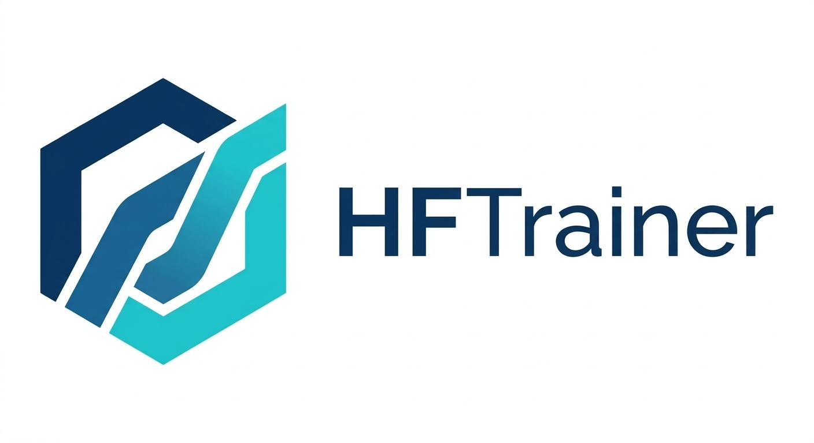

<div align="center">



# HFTrainer

**A config-driven training and inference framework with repository-owned model implementations.**

One implementation tree per model family, one shared bundle for training and
inference, and no runtime delegation to an external model framework.

<p>
  <a href="docs/en/index.md"><strong>Documentation</strong></a> •
  <a href="docs/en/quickstart.md"><strong>Quick Start</strong></a> •
  <a href="docs/en/integration.md"><strong>Integration Guide</strong></a> •
  <a href="docs/zh-cn/index.md"><strong>中文文档</strong></a> •
  <a href="https://github.com/ZeyuLing/HFTrainer/issues"><strong>Issues</strong></a>
</p>

</div>

## Why HFTrainer

Research repositories often combine a model package, a training package, an
inference package, and a separate adapter package. The resulting experiment
may run, but its numerical behavior and artifact format depend on whichever
versions happen to be installed.

HFTrainer uses a stricter boundary:

- model math lives in `hftrainer/models/<implementation>/network/`;
- the bundle owns components, artifact loading, and atomic forward operations;
- the trainer owns losses and update order;
- the pipeline owns inference orchestration and public inputs/outputs;
- configs refer only to classes registered from this repository;
- LoRA, schedulers, tokenizers, and checkpoint loading used by a model are
  implemented locally as part of that execution path.

PyTorch, Accelerate, MMEngine, safetensors, NumPy, Pillow, and similar
infrastructure libraries are still normal dependencies. The hard rule is that
HFTrainer model execution does not import or dynamically resolve another model
implementation such as `transformers`, `diffusers`, `peft`, or separately
installed LTX packages.

This rule is enforced by source-tree AST checks and fresh-process import hooks,
not only documented as a convention.

## Implementations

[Model cards](docs/en/models/index.md) · [Demo data availability](docs/en/models/demo-data.md) · [Validation evidence](docs/en/models/evidence/index.md)

| Implementation | Training | Inference | Local core | Current verification |
| --- | --- | --- | --- | --- |
| [ViT classification](docs/en/models/vit.md) | yes | yes | ViT, image processor, artifact loader | tiny forward/loss/backward; reference logits aligned; `.bin`/safetensors round-trip |
| [LLaMA causal LM](docs/en/models/llama.md) | full + LoRA | yes | LLaMA, KV cache, generation, BPE/WordPiece/Unigram tokenizer | tiny forward/loss/backward/generation; reference logits aligned; sharded artifact support |
| [Stable Diffusion 1.5](docs/en/models/sd15.md) | yes | yes | CLIP, byte-BPE tokenizer, VAE, conditional UNet, DDPM/DDIM/PNDM | checkpoint schema aligned; tiny numerical parity and train/infer round-trip |
| [DMD](docs/en/models/dmd.md) | yes | one-step | reuses the local SD1.5 core | distribution matching, fake-score and teacher paths tested |
| [StyleGAN2](docs/en/models/stylegan2.md) | yes | yes | generator and discriminator | official FFHQ 1024 output and native reload match exactly |
| [Wan T2V](docs/en/models/wan.md) | yes | yes | UMT5 path, tokenizer, video VAE, 3D transformer, flow scheduler | full pretrained component export/reload and tiny reference checks |
| [LTX-Video 2.5](docs/en/models/ltx_video_2_5.md) | LoRA | distilled and dev+LoRA | pinned source reorganized into local model/trainer/pipeline layers; local Gemma text runtime and LoRA | H200 full dev generation, official sample parity, LoRA train/resume/infer and 20-step demo loss measured |
| [MiniMax-H3 Base 768p](docs/en/models/minimax_h3.md) | experimental full/LoRA | T2VA, FL2VA, Ref2VA synchronized A/V | 50-layer Omni Transformer, Qwen3-VL-32B conditioner, visual/audio VAEs, processor and dual flow schedulers | H200 sequential full T2VA, exact official denoising latents, LoRA train/resume/infer and 20-step demo loss measured |

“Reference aligned” refers to isolated development-time numerical checks. The
reference packages are not installed as product dependencies and are not
imported by HFTrainer at runtime.

Wan now uses the complete causal VAE and UMT5 component graph for the published
Wan 2.1 T2V 1.3B checkpoint. Full-weight component outputs match after native
export/reload; tiny numerical checks compare against pinned references. This
does not establish full-resolution video quality or compatibility with every
Wan release. StyleGAN2 additionally includes the native NVIDIA ADA graph and
pretrained FFHQ 1024 generator/discriminator; the original compact demo remains
available separately.

LTX-2.5 is large and gated. Full dev-model GPU execution and independent official
sample parity were verified on 2026-09-28; short demo runs do not establish
training convergence or every supported mode. Standard text encoding,
training, and video generation are wired locally; image-conditioned *prompt
enhancement* is explicitly rejected until the Gemma vision tower is also
implemented locally. Image conditioning for the LTX video model is a separate
pipeline feature.

MiniMax-H3 is substantially larger and its public model agreement contains
territorial exclusions and use restrictions. The repository does not bundle
its weights or tokenizer/config assets. Full-weight T2VA now runs on one H200 by loading the 32B conditioner and 33B
denoiser sequentially. Sample parity and LoRA train/resume/infer are verified;
other conditioning modes, multi-GPU performance and convergence remain separate
validation tasks. See the model cards for one-command recipes, raw demo loss
curves, environment requirements and remaining codec differences.

## Installation

```bash
python -m pip install -e .
```

The base installation intentionally does not install an external model
framework. LTX uses additional media/runtime utilities:

```bash
python -m pip install -e ".[ltx-video-inference]"
python -m pip install -e ".[ltx-video-train]"
# or both
python -m pip install -e ".[ltx-video]"

# MiniMax-H3 media I/O and checkpoint-download helpers
python -m pip install -e ".[minimax-h3]"
```

Choose the correct CUDA-enabled PyTorch wheel for the target machine before
installing LTX extras. LTX-2.5 requires the capabilities guarded by the local
runtime and a suitable Linux/CUDA environment for the real 22B workflow.

## Quick Start

Install the download CLI with `python -m pip install "huggingface_hub>=0.34,<2"`.
Prepare the data described in each model card before training. These commands
download the processed base checkpoints; dataset preparation is separate.

Train ViT:

```bash
hf download ZeyuLing/HFTrainer-ViT-Base-Patch16-224 --local-dir checkpoints/hftrainer/vit
python tools/train.py configs/pretrained/train_vit.py
```

Train and run a local LLaMA LoRA:

```bash
hf download ZeyuLing/HFTrainer-TinyLlama-1.1B-Chat --local-dir checkpoints/hftrainer/llama
python tools/train.py configs/pretrained/train_llama.py

python tools/infer.py \
  --config configs/pretrained/train_llama.py \
  --checkpoint work_dirs/llama_lora_smoke/checkpoint-iter_10 \
  --merge-lora \
  --prompt "Name one primary color."
```

Run SD1.5 inference:

```bash
hf download ZeyuLing/HFTrainer-Stable-Diffusion-1.5 --local-dir checkpoints/hftrainer/sd15
python tools/infer.py \
  --config configs/pretrained/infer_sd15.py --device cuda \
  --prompt "A paper boat in a rain-filled street at dusk." \
  --output outputs/inference/paper_boat.png
```

The inference CLI reads `cfg.pipeline.type` and `cfg.inference.task`. It never
guesses inference behavior from a trainer or implementation class name.

## Video models: verified launch paths

Accept each video model agreement and authenticate with `hf auth login` before
downloading. H3 access requires manual approval. The examples below reproduce the **base inference settings** used for the
2026-09-28 comparison, after preparing the environment and checkpoint assets.
Both models ran on one H200. They are not download-and-run commands for an
unprepared machine. The English model cards contain setup, preprocessing,
training, adapter inference, licensing and remaining validation limits.

### LTX-Video 2.5

Install `.[ltx-video]` and prepare the split checkpoint pack described in the
[LTX model card](docs/en/models/ltx_video_2_5.md). The measured dev workflow used
PyTorch 2.8.0+cu128:

```bash
hf download ZeyuLing/HFTrainer-LTX-2.5-22B-Dev --local-dir checkpoints/hftrainer/ltx_video
python tools/infer_ltx_video.py configs/pretrained/infer_ltx_video.py \
  --prompt "A dancer performs a dance routine with music." --seed 42 \
  --height 512 --width 768 --num-frames 121 --num-inference-steps 30 \
  --negative-prompt "blurry, distorted, low quality, artifacts" \
  --output outputs/ltx_demo.mp4
```

The command retains the official second-stage LoRA and disables a user adapter.
The independent official comparison matched both stages' latents; the face
sample also matched decoded video and audio with deterministic audio decoding.
This does not establish parity for separate distilled weights or every mode.

### MiniMax-H3

Install `.[minimax-h3,minimax-h3-fa3]` and prepare the assets described in the
[H3 model card](docs/en/models/minimax_h3.md). Exact denoising comparison used
PyTorch 2.11.0+cu130 and the pinned FA3 kernel. The sequential entry point
releases the text encoder before loading the denoiser:

```bash
hf download ZeyuLing/HFTrainer-MiniMax-H3-Base-FL2VA --local-dir checkpoints/hftrainer/minimax_h3
export MINIMAX_H3_ROOT="$PWD/checkpoints/hftrainer/minimax_h3"
python tools/validation/infer_h3.py --attention-backend flash_attention_3 \
  --prompt "A dancer performs a dance routine with music." --seed 42 \
  --output outputs/h3_demo.mp4
```

The demonstrated T2VA output is 768 × 768, 124 frames at 24 FPS with 32 kHz
stereo audio. Face-sample text conditions and denoising latents matched the
independent official implementation exactly. Small native VAE differences
remain; decoded media is not claimed to be bit-identical. H3 training is an
experimental rectified-flow recipe, not a released official training recipe.

Both implementations execute locally without a second model repository.
Infrastructure libraries, optional attention kernels and downloaded model
assets remain dependencies. Read the respective model agreements and
[third-party notices](THIRD_PARTY_NOTICES.md) before use or redistribution.

## Checkpoint availability

All eight model families have **processed pretrained HFTrainer bundles on
Hugging Face**. Each English model card provides a pinned revision, one-command
download, training/inference configs, source licenses and validation scope.

| Model | Processed checkpoint | Access |
| :--- | :--- | :--- |
| ViT | [ZeyuLing/HFTrainer-ViT-Base-Patch16-224](https://huggingface.co/ZeyuLing/HFTrainer-ViT-Base-Patch16-224) | Public |
| TinyLlama | [ZeyuLing/HFTrainer-TinyLlama-1.1B-Chat](https://huggingface.co/ZeyuLing/HFTrainer-TinyLlama-1.1B-Chat) | Public |
| Stable Diffusion 1.5 | [ZeyuLing/HFTrainer-Stable-Diffusion-1.5](https://huggingface.co/ZeyuLing/HFTrainer-Stable-Diffusion-1.5) | Public |
| DMD (DMD2 initialization) | [ZeyuLing/HFTrainer-DMD2-SD15-Initialization](https://huggingface.co/ZeyuLing/HFTrainer-DMD2-SD15-Initialization) | Public |
| StyleGAN2-ADA FFHQ 1024 | [ZeyuLing/HFTrainer-StyleGAN2-ADA-FFHQ-1024](https://huggingface.co/ZeyuLing/HFTrainer-StyleGAN2-ADA-FFHQ-1024) | Public |
| Wan 2.1 T2V 1.3B | [ZeyuLing/HFTrainer-Wan2.1-T2V-1.3B](https://huggingface.co/ZeyuLing/HFTrainer-Wan2.1-T2V-1.3B) | Public |
| LTX 2.5 22B Dev | [ZeyuLing/HFTrainer-LTX-2.5-22B-Dev](https://huggingface.co/ZeyuLing/HFTrainer-LTX-2.5-22B-Dev) | Accept agreement |
| MiniMax H3 Base FL2VA | [ZeyuLing/HFTrainer-MiniMax-H3-Base-FL2VA](https://huggingface.co/ZeyuLing/HFTrainer-MiniMax-H3-Base-FL2VA) | Manual access approval |

These are real pretrained weights exported or packaged through our native
bundle contract. They are not random-initialization artifacts or claims of
new training. DMD uses the author's trained DMD2 SD1.5 non-GAN checkpoint as
initialization; it is not an original-DMD-paper reproduction. Demo adapters
and the private video dataset are separate and have not been released.

Training and inference share `cfg.model.from_pretrained`, with
`save_pretrained` and `tools/export_model.py` providing the export path.
[Configs and pinned revisions](configs/pretrained/checkpoints.json) ·
[Conversion and integrity evidence](docs/en/models/evidence/checkpoints/index.md).
These are HFTrainer artifacts hosted on the Hub; no compatibility with another
framework's automatic model loader is implied.

## Demo data and training evidence

**The H3/LTX demo dataset is not published on Hugging Face.** The measured runs
used two local dance clips for training and one held-out clip; source media
and feature caches are not bundled. Redistribution permission has not been
established. A clean public checkout cannot yet download those exact inputs
and reproduce the training measurements end to end.

After preparing compatible caches as described in each model card, launch the
20-step recipes:

```bash
MINIMAX_H3_CACHE_MANIFEST="$PWD/data/h3/train.jsonl" \
HFTRAINER_WORK_DIR="$PWD/outputs/h3_loss_demo" \
python tools/train.py configs/minimax_h3/demo_loss.py \
  --cfg-options val_dataloader.dataset.manifest="$PWD/data/h3/validation.jsonl"

LTX25_PREPROCESSED_DATA="$PWD/data/ltx/.precomputed" \
HFTRAINER_WORK_DIR="$PWD/outputs/ltx_loss_demo" \
python tools/train.py configs/ltx_video/demo_loss.py
```

These short LoRA runs verify execution and record real losses. **Neither trace
demonstrates sustained decrease, convergence or generalization.** The visually
reviewed base samples were not produced by these demo adapters.

| Evidence | H3 | LTX 2.5 |
| --- | --- | --- |
| Full-weight inference | T2VA sample comparison | Dev two-stage sample comparison |
| Short LoRA train / resume / adapter inference | Completed | Completed |
| Raw 20-step loss trace | [Curve](docs/en/models/evidence/h3_loss.png) | [Curve](docs/en/models/evidence/ltx_loss.png) |
| Training convergence | Not established | Not established |
| Exact demo dataset on Hub | Not published | Not published |

[Dataset provenance and release status](docs/en/models/demo-data.md) ·
[Raw measurements and methodology](docs/en/models/evidence/index.md) ·
[Model-card standard](docs/en/models/standard.md)

## Repository Standard

```text
hftrainer/
  models/
    <implementation_id>/
      network/          model math and model-specific primitives
      bundle.py         components, atomic forwards, artifact boundary
      checkpoint.py     implementation artifact schema when needed
  trainers/
    <implementation_id>/
      trainer.py        losses and update order
  pipelines/
    <implementation_id>/
      pipeline.py       inference graph and public I/O
  tasks/
    <reusable_task>/    only genuinely reusable task contracts
  datasets/
    <data_contract>/    records, transforms, and batching
  evaluation/
    <task_contract>/    reusable metrics
configs/
  <implementation_id>/
```

The same `implementation_id` is used across model, trainer, pipeline, and
config whenever behavior belongs to one concrete method. A task directory is
used only when the code is truly reusable across implementations. For example,
ViT uses the reusable `image_classification` task trainer/pipeline, while
SD1.5, DMD, Wan, StyleGAN2, and LTX keep method-specific trainers and
pipelines.

Do not add task aliases such as `models/classification` or mix task names and
paper/model names at the same model-package level.

## Adding a Model

An integration is complete only when all of the following are true:

1. Core model code is present under `hftrainer/models/<implementation>/network`.
2. Config component types resolve through `MODEL_COMPONENTS` to classes whose
   module starts with `hftrainer.models.`.
3. `bundle.py` imports only local model components and owns atomic operations.
4. The bundle provides strict local artifact loading/saving; missing keys,
   shape mismatches, and low coverage are not silently accepted.
5. Trainer and pipeline reuse bundle operations instead of maintaining another
   model copy.
6. Tiny forward, loss, backward, inference, and artifact round-trip tests pass.
7. The forbidden-dependency test still passes in a process that actively blocks
   external model packages.
8. An English model card follows the [shared standard](docs/en/models/standard.md),
   with launch commands, data availability, measured evidence and explicit limits.

See the [English integration guide](docs/en/integration.md) or
[中文模型接入指南](docs/zh-cn/integration.md).

## Verification

```bash
python -m pytest -q
python -m compileall -q hftrainer tools
python -m build
```

The focused tests include:

- source-tree forbidden-import scanning;
- blocked-package fresh-process imports;
- local tokenizer and LoRA contracts;
- tiny model forward/loss/backward/generation tests;
- artifact checksum, schema, tamper, and round-trip tests;
- all shipped config imports and registry resolution;
- LTX split-checkpoint, preprocessing, packaged trainer, and inference contracts.
- MiniMax-H3 packed-layout, scheduler, transformer, Qwen/tokenizer, dual-VAE,
  cached-training, synchronized-inference, and strict-artifact contracts.

## Documentation

| Topic | English | 简体中文 |
| --- | --- | --- |
| Home | [docs/en/index.md](docs/en/index.md) | [docs/zh-cn/index.md](docs/zh-cn/index.md) |
| Installation | [docs/en/installation.md](docs/en/installation.md) | [docs/zh-cn/installation.md](docs/zh-cn/installation.md) |
| Quick start | [docs/en/quickstart.md](docs/en/quickstart.md) | [docs/zh-cn/quickstart.md](docs/zh-cn/quickstart.md) |
| Integration standard | [docs/en/integration.md](docs/en/integration.md) | [docs/zh-cn/integration.md](docs/zh-cn/integration.md) |
| Architecture | [docs/en/architecture.md](docs/en/architecture.md) | [docs/zh-cn/architecture.md](docs/zh-cn/architecture.md) |
| ModelBundle | [docs/en/design/model_bundle.md](docs/en/design/model_bundle.md) | [docs/zh-cn/design/model_bundle.md](docs/zh-cn/design/model_bundle.md) |
| [LTX-Video 2.5](docs/en/models/ltx_video_2_5.md) | [docs/en/models/ltx_video_2_5.md](docs/en/models/ltx_video_2_5.md) | [docs/zh-cn/models/ltx_video_2_5.md](docs/zh-cn/models/ltx_video_2_5.md) |
| MiniMax-H3 | [docs/en/models/minimax_h3.md](docs/en/models/minimax_h3.md) | [docs/zh-cn/models/minimax_h3.md](docs/zh-cn/models/minimax_h3.md) |

## Acknowledgements and Provenance

HFTrainer uses MMEngine for configuration/registries and Accelerate for
distributed runtime orchestration. Model execution is repository-owned.

Some local implementations were validated against public reference
implementations during development. Those references are not runtime
dependencies. LTX is a modified pinned source snapshot and retains its own
license, notices, and use restrictions as described above.
MiniMax-H3 model materials likewise retain their Community License terms;
HFTrainer ships the complete agreement, required notice, and pinned
modification record but no pretrained model artifacts.
