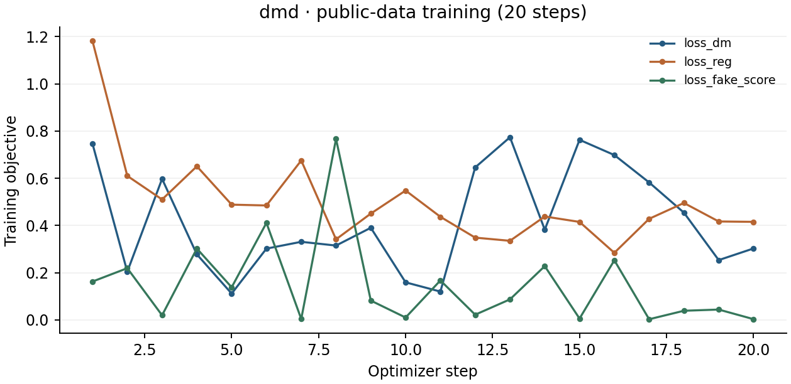

# DMD · SD1.5 with DMD2 initialization

One-step text-to-image distillation with repository-owned model, trainer and inference code.

**Verified:** 20 real-data training steps, saved checkpoint and native checkpoint-only base inference. **Convergence is not established.**

[All models](index.md) · [Settings](#settings-and-checkpoints) · [Train](#train) · [Infer](#infer) · [Evidence](#evidence-and-loss) · [Demos](#demos)

## At a glance

| Property | Released setting |
| :--- | :--- |
| Model | DMD2 SD1.5 non-GAN initialization |
| Training | Generator + fake-score UNet updates |
| Training input | 512 × 512; 20-step online teacher targets |
| Public dataset | [smithsonian_butterflies](https://huggingface.co/datasets/ZeyuLing/hftrainer_smithsonian_butterflies) |
| Runtime | Local HFTrainer implementation; supporting PyTorch/media libraries and model assets remain dependencies |

## Sources

[Original paper / report](https://arxiv.org/abs/2311.18828) · [Original code](https://github.com/tianweiy/DMD2) · [DMD2 initialization paper](https://arxiv.org/abs/2405.14867)

The original repository is provenance, not a runtime checkout requirement. [Third-party notices](https://github.com/ZeyuLing/HFTrainer/blob/main/THIRD_PARTY_NOTICES.md) preserve implementation and asset terms.

## Settings and checkpoints

| Setting | Training config | Processed checkpoint | Access |
| :--- | :--- | :--- | :--- |
| DMD2 SD1.5 non-GAN initialization | [config.py](https://github.com/ZeyuLing/HFTrainer/blob/main/configs/public_data/dmd.py) | [HFTrainer-DMD2-SD15-Initialization](https://huggingface.co/ZeyuLing/HFTrainer-DMD2-SD15-Initialization) | Public |

Only the setting above is a released HFTrainer artifact. Its [root config.json](https://huggingface.co/ZeyuLing/HFTrainer-DMD2-SD15-Initialization/resolve/0e4c7d6ccae0832545f511aa9057f8c2510147f8/config.json), weights and all task-required component configs, processors and schedulers are included together. Inference needs **only the checkpoint path or Hub ID**, plus task inputs.

Pinned weight revision: [`0e4c7d6ccae0`](https://huggingface.co/ZeyuLing/HFTrainer-DMD2-SD15-Initialization/tree/0e4c7d6ccae0832545f511aa9057f8c2510147f8). [Original conversion evidence](evidence/checkpoints/dmd.json) describes the initial export; the current revision adds checkpoint-only dispatch metadata without changing tensors.

## Setup

Run from the repository root:

```bash
python -m pip install -e "."
python -m pip install "huggingface_hub>=0.34,<2"
```

Verified on one NVIDIA H200 with PyTorch 2.8.0+cu128. This is the tested environment, not a measured minimum-memory requirement.

## Data

The recipe downloads [`ZeyuLing/hftrainer_smithsonian_butterflies`](https://huggingface.co/datasets/ZeyuLing/hftrainer_smithsonian_butterflies/tree/c34c2176cf5d0d2a1d64f034a83f989dddbf71d2) to `data/hftrainer_smithsonian_butterflies`. Split counts: **900 train / 100 validation / 0 test**. Dataset source, license, transformations and checksum verification are documented in [Public demo datasets](demo-data.md).

Model features are cached locally when required. The script never substitutes synthetic samples for missing real media.

## Train

One command downloads pinned data and weights, prepares required caches, and runs the 20-step recipe:

```bash
python tools/run_public_demo.py dmd
```

Reuse downloaded weights with `--checkpoint path/to/complete_bundle`; change the output directory with `--work-dir path/to/run`. The underlying command is `python tools/train.py configs/public_data/dmd.py`. Seed: **42**. Training logs and checkpoints are saved under `work_dirs/public_data/dmd/`. If you reused a custom checkpoint directory, set `HFTRAINER_CHECKPOINT` to that directory before directly invoking training, resume or export commands.

The final resumable checkpoint is `work_dirs/public_data/dmd/checkpoint-iter_20`. For a longer resumed run, keep the same checkpoint/data setting:

```bash
python tools/train.py configs/public_data/dmd.py --auto-resume \
  --cfg-options train_cfg.max_iters=40
```

## Infer

Run the processed **pretrained base**, independently of any training config:

```bash
python tools/infer.py --model ZeyuLing/HFTrainer-DMD2-SD15-Initialization \
  --revision 0e4c7d6ccae0832545f511aa9057f8c2510147f8 --device cuda --seed 42 \
  --prompt "A photograph of a butterfly on a flower, detailed wings, natural daylight." \
  --output outputs/dmd.png
```

`--model` also accepts a local complete checkpoint directory. A resumable training checkpoint is not a standalone model: export with `tools/export_model.py` using the matching training config, then pass the exported directory to `--model`. [Artifact and configuration contract](standard.md#checkpoint-and-execution-contract).

To package this training run as a complete checkpoint (including its frozen base components):

```bash
python tools/export_model.py --config configs/public_data/dmd.py \
  --checkpoint work_dirs/public_data/dmd/checkpoint-iter_20 --output exports/dmd
```

Then run the inference command above with `--model exports/dmd` and omit `--revision`. Complete exports duplicate the base weights; allow sufficient disk space.

## Evidence and loss

All three UNets load strictly; generator output matches exactly after export/reload. Distribution-matching, teacher and fake-score paths have focused tests.



[Raw training record](evidence/public_data/dmd.json) · [Training log](evidence/public_data/dmd.log)

These are raw, unsmoothed objectives on the public dataset. Twenty steps establish pipeline execution, not convergence. Loss values are not comparable across models.

No held-out perceptual quality metric was measured for this short run.

## Demos


Untouched published base; seed 42. The prompt and sampler settings are the inference command above. This image is not an output of the 20-step fine-tuned model.

## Limitations

The author-trained DMD2 checkpoint initializes the HFTrainer DMD objective; this is not an original-DMD reproduction. This recipe conditions on butterfly captions and generates regression targets with the frozen teacher online; it does not use butterfly pixels as teacher target images. DMD2-derived weights retain upstream non-commercial/share-alike notices; SD1.5 components retain CreativeML OpenRAIL-M.

## Citation

```bibtex
@misc{yin2024dmd,
  title = {One-step Diffusion with Distribution Matching Distillation},
  author = {Tianwei Yin and others},
  year = {2024},
  eprint = {2311.18828},
  archivePrefix = {arXiv},
  url = {https://arxiv.org/abs/2311.18828}
}
@inproceedings{yin2024improved,
  title = {Improved Distribution Matching Distillation for Fast Image Synthesis},
  author = {Tianwei Yin and others},
  booktitle = {NeurIPS},
  year = {2024},
  url = {https://arxiv.org/abs/2405.14867}
}
```

Also retain the [dataset citation and attribution](demo-data.md#provenance-and-transformations).
