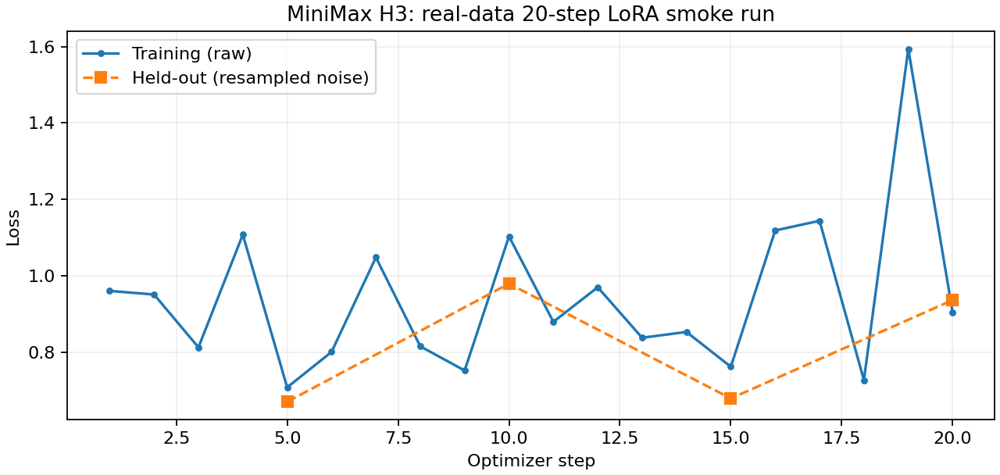
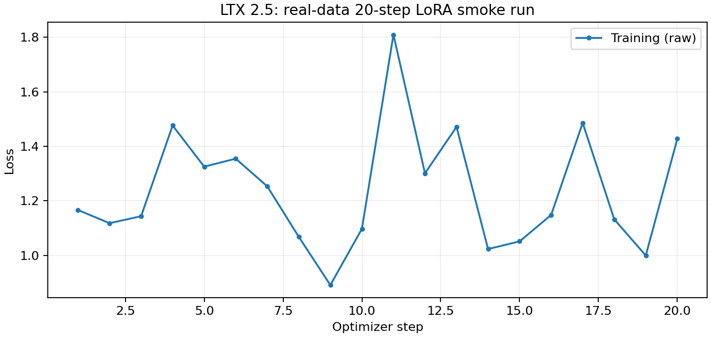

# Video training evidence

[Model cards](../index.md) · [Dataset provenance](../demo-data.md)

Measured on 2026-09-28, one H200, PyTorch 2.8.0+cu128, rank = alpha = 2, batch size 1, seed 42. Both recipes ran 20 steps on two clips. These adapters did not produce the base face samples used for visual review.

| Model | First loss | Last loss | First five mean | Last five mean |
| :--- | ---: | ---: | ---: | ---: |
| H3 | 0.9609 | 0.9048 | 0.90848 | 1.09794 |
| LTX 2.5 | 1.16677 | 1.42767 | 1.24615 | 1.23894 |

Neither trace demonstrates sustained decrease or convergence. Noise and timesteps are resampled. H3 held-out loss is also stochastic; LTX generation validation was disabled in this run. All 20 training points are shown without smoothing.

[Raw loss CSV](loss.csv) · [Computed statistics](summary.json) · [LTX metrics](ltx_metrics.jsonl) · [Runtime import audit](runtime_audit.json)





The runtime audit scanned 281 production files and ran import probes with eight external model-package roots blocked. It found no forbidden imports. This is evidence for the audited paths, not exhaustive execution of every model branch. Kernel-only FA3 and ordinary infrastructure dependencies remain allowed.

To regenerate plots from your own run, install matplotlib and run from the repository root:

```bash
python tools/validation/plot_demo_loss.py \
  --h3-log outputs/demo/h3.log \
  --ltx-metrics outputs/demo/ltx/metrics.jsonl \
  --output outputs/demo/plots
python tools/validation/audit_video_runtime.py
```

## Checkpoint releases

See the [pretrained artifact release checks](checkpoints/index.md) for download integrity, native export/reload and one-step entry-point evidence. These are separate from the video loss traces above.
