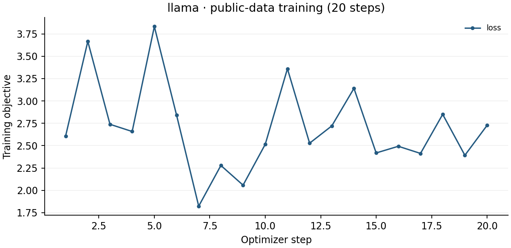

# TinyLlama · 1.1B Chat

Plain-text causal language modelling with repository-owned model, trainer and inference code.

**Verified:** 20 real-data training steps, saved checkpoint and native checkpoint-only base inference. **Convergence is not established.**

[All models](index.md) · [Settings](#settings-and-checkpoints) · [Train](#train) · [Infer](#infer) · [Evidence](#evidence-and-loss) · [Demos](#demos)

## At a glance

| Property | Released setting |
| :--- | :--- |
| Model | 1.1B · Chat v1.0 |
| Training | Rank-16 LoRA, all linear layers |
| Training input | 256 tokens per nonempty line |
| Public dataset | [wikitext2](https://huggingface.co/datasets/ZeyuLing/hftrainer_wikitext2) |
| Runtime | Local HFTrainer implementation; supporting PyTorch/media libraries and model assets remain dependencies |

## Sources

[Original paper / report](https://arxiv.org/abs/2401.02385) · [Original code](https://github.com/jzhang38/TinyLlama)

The original repository is provenance, not a runtime checkout requirement. [Third-party notices](https://github.com/ZeyuLing/HFTrainer/blob/main/THIRD_PARTY_NOTICES.md) preserve implementation and asset terms.

## Settings and checkpoints

| Setting | Training config | Processed checkpoint | Access |
| :--- | :--- | :--- | :--- |
| 1.1B · Chat v1.0 | [config.py](https://github.com/ZeyuLing/HFTrainer/blob/main/configs/public_data/llama.py) | [HFTrainer-TinyLlama-1.1B-Chat](https://huggingface.co/ZeyuLing/HFTrainer-TinyLlama-1.1B-Chat) | Public |

Only the setting above is a released HFTrainer artifact. Its [root config.json](https://huggingface.co/ZeyuLing/HFTrainer-TinyLlama-1.1B-Chat/resolve/f782b84ba99cef1c24a5d216801a70117647980c/config.json), weights and all task-required component configs, processors and schedulers are included together. Inference needs **only the checkpoint path or Hub ID**, plus task inputs.

Pinned weight revision: [`f782b84ba99c`](https://huggingface.co/ZeyuLing/HFTrainer-TinyLlama-1.1B-Chat/tree/f782b84ba99cef1c24a5d216801a70117647980c). [Original conversion evidence](evidence/checkpoints/llama.json) describes the initial export; the current revision adds checkpoint-only dispatch metadata without changing tensors.

## Setup

Run from the repository root:

```bash
python -m pip install -e "."
python -m pip install "huggingface_hub>=0.34,<2"
```

Verified on one NVIDIA H200 with PyTorch 2.8.0+cu128. This is the tested environment, not a measured minimum-memory requirement.

## Data

The recipe downloads [`ZeyuLing/hftrainer_wikitext2`](https://huggingface.co/datasets/ZeyuLing/hftrainer_wikitext2/tree/e9aaa6354f59bf18cb8d0fe53cd2e0dce1dd9aa4) to `data/hftrainer_wikitext2`. Split counts: **23767 train / 2461 validation / 2891 test**. Dataset source, license, transformations and checksum verification are documented in [Public demo datasets](demo-data.md).

Model features are cached locally when required. The script never substitutes synthetic samples for missing real media.

## Train

One command downloads pinned data and weights, prepares required caches, and runs the 20-step recipe:

```bash
python tools/run_public_demo.py llama
```

Reuse downloaded weights with `--checkpoint path/to/complete_bundle`; change the output directory with `--work-dir path/to/run`. The underlying command is `python tools/train.py configs/public_data/llama.py`. Seed: **42**. Training logs and checkpoints are saved under `work_dirs/public_data/llama/`. If you reused a custom checkpoint directory, set `HFTRAINER_CHECKPOINT` to that directory before directly invoking training, resume or export commands.

The final resumable checkpoint is `work_dirs/public_data/llama/checkpoint-iter_20`. For a longer resumed run, keep the same checkpoint/data setting:

```bash
python tools/train.py configs/public_data/llama.py --auto-resume \
  --cfg-options train_cfg.max_iters=40
```

## Infer

Run the processed **pretrained base**, independently of any training config:

```bash
python tools/infer.py --model ZeyuLing/HFTrainer-TinyLlama-1.1B-Chat \
  --revision f782b84ba99cef1c24a5d216801a70117647980c --device cuda --seed 42 \
  --prompt "The butterfly is" --max-new-tokens 48
```

`--model` also accepts a local complete checkpoint directory. A resumable training checkpoint is not a standalone model: export with `tools/export_model.py` using the matching training config, then pass the exported directory to `--model`. [Artifact and configuration contract](standard.md#checkpoint-and-execution-contract).

To package this training run as a complete checkpoint (including its frozen base components):

```bash
python tools/export_model.py --config configs/public_data/llama.py \
  --checkpoint work_dirs/public_data/llama/checkpoint-iter_20 --output exports/llama
```

Then run the inference command above with `--model exports/llama` and omit `--revision`. Complete exports duplicate the base weights; allow sufficient disk space.

## Evidence and loss

Real TinyLlama tokenization matches the reference on Unicode, whitespace and special-token cases; full pretrained logits match after native reload.



[Raw training record](evidence/public_data/llama.json) · [Training log](evidence/public_data/llama.log)

These are raw, unsmoothed objectives on the public dataset. Twenty steps establish pipeline execution, not convergence. Loss values are not comparable across models.

**Held-out line-wise perplexity:** base 12.201; trained 9.325. Evaluated on the first 128 nonempty validation lines, truncated independently to 256 tokens and aggregated by predicted-token count. This is **not the standard concatenated WikiText benchmark**. [Exact protocol and counts](evidence/public_data/llama_evaluation.json).

## Demos

[Generated text from the checkpoint-only CLI](evidence/public_data/llama_demo.txt). Untouched base; prompt `The butterfly is`, 48 new tokens, seed 42.

## Limitations

This plain-text continuation example starts from the Chat checkpoint and does not use an instruction template. It is not an instruction-following evaluation. Other LLaMA sizes are not packaged settings.

## Citation

```bibtex
@misc{zhang2024tinyllama,
  title = {TinyLlama: An Open-Source Small Language Model},
  author = {Peiyuan Zhang and Guangtao Zeng and Tianduo Wang and Wei Lu},
  year = {2024},
  eprint = {2401.02385},
  archivePrefix = {arXiv},
  url = {https://arxiv.org/abs/2401.02385}
}
```

Also retain the [dataset citation and attribution](demo-data.md#provenance-and-transformations).
