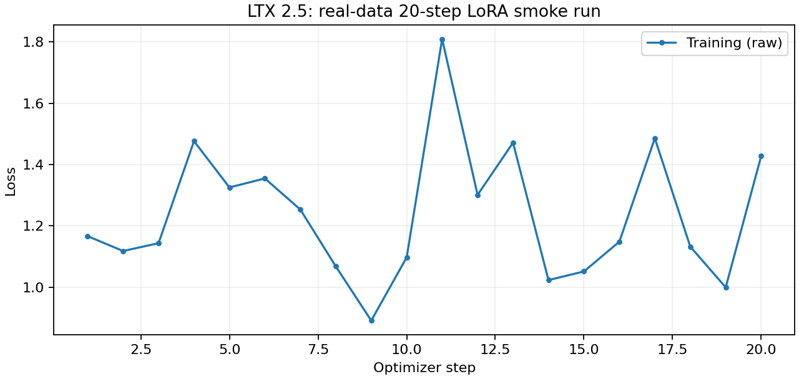

# LTX-Video 2.5

Two-stage text-to-video and audio generation with local Gemma conditioning and LoRA training.

**Verification:** Full-weight dev inference and short LoRA train/resume/infer verified on one H200 (2026-09-28)

**Runtime:** Repository-owned model, trainer and pipeline; infrastructure libraries and model assets remain dependencies.

[All models](index.md) · [Setup](#setup) · [Checkpoint](#checkpoint) · [Train](#train) · [Infer](#infer) · [Evidence](#evidence-and-loss)

## At a glance

| Item | Status |
| :--- | :--- |
| Implementation | Local to HFTrainer |
| Demo data | See [data availability](demo-data.md) |
| Convergence | Not established by the evidence on this card |

## Setup

Run commands from the repository root. Install the environment below, download the checkpoint, and prepare data before training.

```bash
python -m pip install -e ".[ltx-video]"
python -m pip install "huggingface_hub>=0.34,<2"
```

Tested with PyTorch 2.8.0+cu128. The downloadable artifact preserves all [required component roles](ltx_video_2_5_reference.md#checkpoint-pack). The projected Gemma encoder is required; stock Gemma is not interchangeable.

Download the processed base bundle below. The demo adapters are not included in this release.

## Checkpoint

[ZeyuLing/HFTrainer-LTX-2.5-22B-Dev](https://huggingface.co/ZeyuLing/HFTrainer-LTX-2.5-22B-Dev) · [pinned revision](https://huggingface.co/ZeyuLing/HFTrainer-LTX-2.5-22B-Dev/tree/d0aabb6aa3e1502d216d0cdd481c2bf116acaf73)

Accept the model agreement on the Hub page and run `hf auth login` first. This release packages real pretrained weights in a complete **HFTrainer bundle**. Trainer and Pipeline share the repository-owned `from_pretrained` loader. Conversion, source attribution and validation scope are recorded below.

```bash
hf download ZeyuLing/HFTrainer-LTX-2.5-22B-Dev \
  --revision d0aabb6aa3e1502d216d0cdd481c2bf116acaf73 \
  --local-dir checkpoints/hftrainer/ltx_video
export HFTRAINER_CHECKPOINT="$PWD/checkpoints/hftrainer/ltx_video"
```

[Conversion and validation record](evidence/checkpoints/ltx.json). Base weights are separate from demo adapters and datasets. To export a fine-tuned bundle:

```bash
python tools/export_model.py --config configs/pretrained/train_ltx_video.py \
  --checkpoint PATH_TO_TRAINING_CHECKPOINT --output outputs/ltx_video_export
```

## Data

The measured run used two training clips (Ballet427 and Popular-Jazz110) and one held-out clip (Classic-dunhuang8), each initially excerpted to six seconds. **These videos and caches are not published on Hugging Face.** See [provenance and availability](demo-data.md). Supply your own authorized videos for a new run. LTX training caches use 256 × 256 × 49 frames. [Preprocess a caption/video manifest](ltx_video_2_5_reference.md#preprocessing) before training; rebuild caches created before the tokenizer correction.

## Train

```bash
LTX25_PREPROCESSED_DATA="$PWD/data/ltx/.precomputed" \
HFTRAINER_WORK_DIR="$PWD/outputs/ltx_loss_demo" \
python tools/train.py configs/pretrained/train_ltx_video.py
```

This runs 20 steps. Local `metrics.jsonl` records loss, step, learning rate and sigma buckets even when W&B is disabled. See the [full LoRA recipe](ltx_video_2_5_reference.md#lora-training).

## Infer

```bash
python tools/infer_ltx_video.py configs/pretrained/infer_ltx_video.py \
  --prompt "A dancer performs a dance routine with music." --seed 42 \
  --height 512 --width 768 --num-frames 121 --num-inference-steps 30 \
  --negative-prompt "blurry, distorted, low quality, artifacts" \
  --output outputs/ltx_demo.mp4
```

This generates the base model sample while retaining the official second-stage LoRA. For a trained adapter, follow [adapter inference](ltx_video_2_5_reference.md#dev-inference-with-a-trained-lora).

## Evidence and loss

The independent official dev two-stage comparison matched conditions and both stages’ latents for dance and face prompts. Face-sample decoded pixels and audio matched exactly with deterministic audio decoding on both sides. The reviewed base face sample was accepted visually.



These are raw 20-step LoRA traces on two clips, without smoothing. They demonstrate execution, **not sustained loss decrease, convergence or generalization**. [Raw measurements and methodology](evidence/index.md). No held-out curve was measured for this run.

## Limitations

Separate distilled weights, HDR, image conditioning and multi-GPU execution were not fully tested in this comparison. Image-conditioned Gemma prompt enhancement is unsupported; it is distinct from video image conditioning. Short adapter execution checks do not establish adapter quality.

## Sources and license

[Pinned upstream revision, modifications and LTX-2.x license](ltx_video_2_5_reference.md#source-and-license). The implementation snapshot is `400fd31054597515f47125691032c04b1c3ee24e`.
