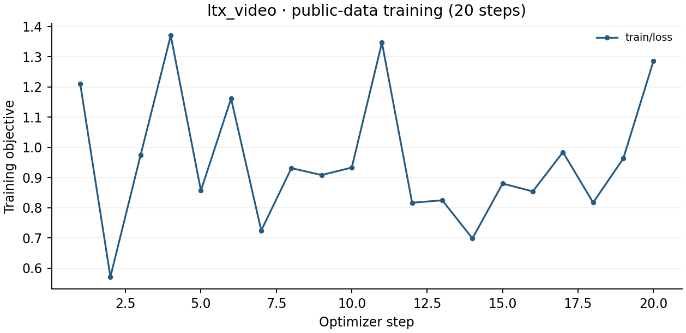
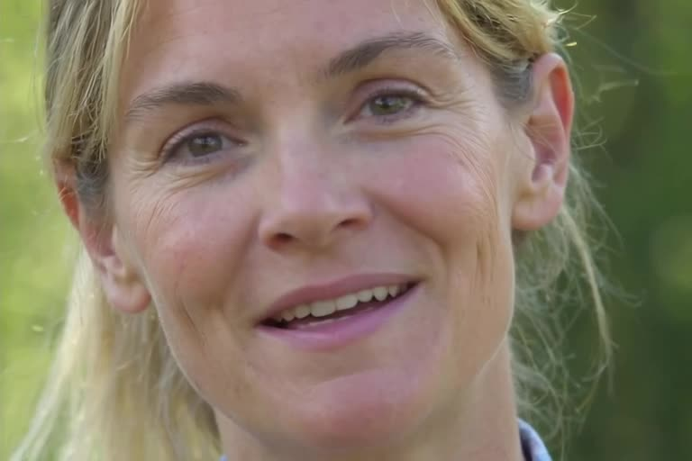

# LTX-Video · 2.5 22B Dev

Text-to-audio-video generation with repository-owned model, trainer and inference code.

**Verified:** 20 real-data training steps, saved checkpoint and native checkpoint-only base inference. **Convergence is not established.**

[All models](index.md) · [Settings](#settings-and-checkpoints) · [Train](#train) · [Infer](#infer) · [Evidence](#evidence-and-loss) · [Demos](#demos)

## At a glance

| Property | Released setting |
| :--- | :--- |
| Model | 22B Dev · two-stage + distilled stage-two LoRA |
| Training | Rank-2 LoRA on cached audio/video/text features |
| Training input | 256 × 256 × 49 frames; synchronized audio |
| Public dataset | [crema_d_mini](https://huggingface.co/datasets/ZeyuLing/hftrainer_crema_d_mini) |
| Runtime | Local HFTrainer implementation; supporting PyTorch/media libraries and model assets remain dependencies |

## Sources

[Original paper / report](https://arxiv.org/abs/2601.03233) · [Original code](https://github.com/Lightricks/LTX-2)

The original repository is provenance, not a runtime checkout requirement. [Third-party notices](https://github.com/ZeyuLing/HFTrainer/blob/main/THIRD_PARTY_NOTICES.md) preserve implementation and asset terms.

## Settings and checkpoints

| Setting | Training config | Processed checkpoint | Access |
| :--- | :--- | :--- | :--- |
| 22B Dev · two-stage + distilled stage-two LoRA | [config.py](https://github.com/ZeyuLing/HFTrainer/blob/main/configs/public_data/ltx_video.py) | [HFTrainer-LTX-2.5-22B-Dev](https://huggingface.co/ZeyuLing/HFTrainer-LTX-2.5-22B-Dev) | Accept agreement |

Only the setting above is a released HFTrainer artifact. Its [root config.json](https://huggingface.co/ZeyuLing/HFTrainer-LTX-2.5-22B-Dev/resolve/7183113f99d3bbe80500ecb852c6a6897d593cbf/config.json), weights and all task-required component configs, processors and schedulers are included together. Inference needs **only the checkpoint path or Hub ID**, plus task inputs.

Pinned weight revision: [`7183113f99d3`](https://huggingface.co/ZeyuLing/HFTrainer-LTX-2.5-22B-Dev/tree/7183113f99d3bbe80500ecb852c6a6897d593cbf). [Original conversion evidence](evidence/checkpoints/ltx.json) describes the initial export; the current revision adds checkpoint-only dispatch metadata without changing tensors.

## Setup

Run from the repository root:

```bash
python -m pip install -e ".[ltx-video]"
python -m pip install "huggingface_hub>=0.34,<2"
```

Verified on one NVIDIA H200 with PyTorch 2.8.0+cu128. This is the tested environment, not a measured minimum-memory requirement. The complete artifact is about 75 GB; it includes the projected Gemma encoder, both VAEs, upsampler and second-stage LoRA. Install system FFmpeg (`ffmpeg` and `ffprobe`) for media preparation.

**Access:** Accept agreement. Open the checkpoint page, satisfy its model agreement, and run `hf auth login` before the commands below.

## Data

The recipe downloads [`ZeyuLing/hftrainer_crema_d_mini`](https://huggingface.co/datasets/ZeyuLing/hftrainer_crema_d_mini/tree/1188c5d5fac3e69ea014831ab4409f729f8eda81) to `data/hftrainer_crema_d_mini`. Split counts: **24 train / 8 validation / 0 test**. Dataset source, license, transformations and checksum verification are documented in [Public demo datasets](demo-data.md).

Model features are cached locally. Remove this model's directory under `data/hftrainer_crema_d_mini/.cache/` before changing the base checkpoint or preprocessing geometry. The script never substitutes synthetic samples for missing real media.

## Train

One command downloads pinned data and weights, prepares required caches, and runs the 20-step recipe:

```bash
python tools/run_public_demo.py ltx_video
```

Reuse downloaded weights with `--checkpoint path/to/complete_bundle`; change the output directory with `--work-dir path/to/run`. The underlying command is `python tools/train.py configs/public_data/ltx_video.py`. Seed: **42**. Training logs and checkpoints are saved under `work_dirs/public_data/ltx_video/`. If you reused a custom checkpoint directory, set `HFTRAINER_CHECKPOINT` to that directory before directly invoking training, resume or export commands.

The managed trainer writes `metrics.jsonl`, a LoRA safetensors file and a full training-state checkpoint. See the [resume and adapter contract](ltx_video_2_5_reference.md#lora-training).

Resume with `python tools/train.py configs/public_data/ltx_video.py --auto-resume --cfg-options trainer.native_config.optimization.steps=40`. This recipe saves full optimizer state alongside its LoRA.

## Infer

Run the processed **pretrained base**, independently of any training config:

```bash
python tools/infer.py --model ZeyuLing/HFTrainer-LTX-2.5-22B-Dev \
  --revision 7183113f99d3bbe80500ecb852c6a6897d593cbf --device cuda --seed 42 \
  --prompt "A close-up of a woman speaking calmly to the camera, natural facial expressions, soft daylight, detailed face, steady camera." \
  --height 512 --width 768 --num-frames 121 --num-steps 30 --output outputs/ltx.mp4
```

`--model` also accepts a local complete checkpoint directory. A resumable training checkpoint is not a standalone model: export with `tools/export_model.py` using the matching training config, then pass the exported directory to `--model`. [Artifact and configuration contract](standard.md#checkpoint-and-execution-contract).

To package this training run as a complete checkpoint (including its frozen base components):

```bash
python tools/export_model.py --config configs/public_data/ltx_video.py \
  --checkpoint work_dirs/public_data/ltx_video/checkpoints/lora_weights_step_00020.safetensors --output exports/ltx_video
```

Then run the inference command above with `--model exports/ltx_video` and omit `--revision`. Complete exports duplicate the base weights; allow sufficient disk space.

## Evidence and loss

[Detailed implementation notes](ltx_video_2_5_reference.md) · [Historical official comparison protocol and measurements](evidence/official_base_comparison.json).

Earlier independent official dev comparisons matched conditioning and both denoising stages. The face sample matched decoded pixels and audio when both sides used deterministic audio decoding. This comparison used the base, not the new CREMA-D adapter.



[Raw training record](evidence/public_data/ltx_video.json) · [Training log](evidence/public_data/ltx_video.log)

These are raw, unsmoothed objectives on the public dataset. Twenty steps establish pipeline execution, not convergence. Loss values are not comparable across models.

No held-out perceptual quality metric was measured for this short run.

## Demos

[](evidence/public_data/ltx_video_demo.mp4)

[Play/download the generated video](evidence/public_data/ltx_video_demo.mp4). Untouched published base, seed 42; prompt and sampler settings match the inference command above. Includes generated stereo audio. This is separate from the short public-data fine-tuning run.

## Limitations

The paper link describes the LTX-2 foundation; the original repository documents the 2.5 release. Separate distilled weights, HDR, image conditioning and multi-GPU execution were not fully validated. Image-conditioned Gemma prompt enhancement is unsupported. Accept the LTX-2.x model agreement before downloading.

## Citation

```bibtex
@misc{hacohen2026ltx2,
  title = {LTX-2: Efficient Joint Audio-Visual Foundation Model},
  author = {Yoav HaCohen and others},
  year = {2026},
  eprint = {2601.03233},
  archivePrefix = {arXiv},
  url = {https://arxiv.org/abs/2601.03233}
}
```

Also retain the [dataset citation and attribution](demo-data.md#provenance-and-transformations).
