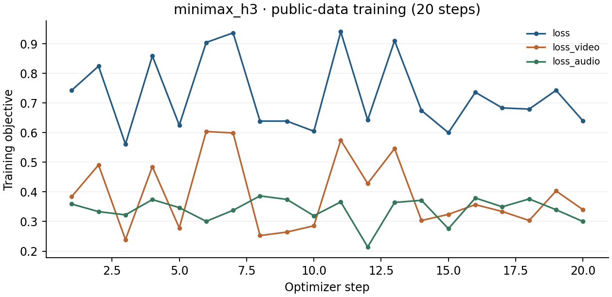

# MiniMax-H3 · Base FL2VA

Text-to-audio-video generation with repository-owned model, trainer and inference code.

**Verified:** 20 real-data training steps, saved checkpoint and native checkpoint-only base inference. **Convergence is not established.**

[All models](index.md) · [Settings](#settings-and-checkpoints) · [Train](#train) · [Infer](#infer) · [Evidence](#evidence-and-loss) · [Demos](#demos)

## At a glance

| Property | Released setting |
| :--- | :--- |
| Model | Base FL2VA · 33B denoiser + 32B conditioner |
| Training | Rank-2 LoRA on cached audio/video/text features |
| Training input | 128 × 128 × 56 frames; synchronized audio |
| Public dataset | [crema_d_mini](https://huggingface.co/datasets/ZeyuLing/hftrainer_crema_d_mini) |
| Runtime | Local HFTrainer implementation; supporting PyTorch/media libraries and model assets remain dependencies |

## Sources

[Original technical overview](https://github.com/MiniMax-AI/MiniMax-H3#system-overview) · [Original code](https://github.com/MiniMax-AI/MiniMax-H3)

The original repository is provenance, not a runtime checkout requirement. [Third-party notices](https://github.com/ZeyuLing/HFTrainer/blob/main/THIRD_PARTY_NOTICES.md) preserve implementation and asset terms.

## Settings and checkpoints

| Setting | Training config | Processed checkpoint | Access |
| :--- | :--- | :--- | :--- |
| Base FL2VA · 33B denoiser + 32B conditioner | [config.py](https://github.com/ZeyuLing/HFTrainer/blob/main/configs/public_data/minimax_h3.py) | [HFTrainer-MiniMax-H3-Base-FL2VA](https://huggingface.co/ZeyuLing/HFTrainer-MiniMax-H3-Base-FL2VA) | Manual access approval |

Only the setting above is a released HFTrainer artifact. Its [root config.json](https://huggingface.co/ZeyuLing/HFTrainer-MiniMax-H3-Base-FL2VA/resolve/a3b24b9d13fac9c38949ef737e9cb4b98ffe2fb1/config.json), weights and all task-required component configs, processors and schedulers are included together. Inference needs **only the checkpoint path or Hub ID**, plus task inputs.

Pinned weight revision: [`a3b24b9d13fa`](https://huggingface.co/ZeyuLing/HFTrainer-MiniMax-H3-Base-FL2VA/tree/a3b24b9d13fac9c38949ef737e9cb4b98ffe2fb1). [Original conversion evidence](evidence/checkpoints/h3.json) describes the initial export; the current revision adds checkpoint-only dispatch metadata without changing tensors.

## Setup

Run from the repository root:

```bash
python -m pip install -e ".[minimax-h3]"
python -m pip install "huggingface_hub>=0.34,<2"
```

Verified on one NVIDIA H200 with PyTorch 2.8.0+cu128. This is the tested environment, not a measured minimum-memory requirement. The complete artifact is about 140 GB. Inference uses sequential component placement; substantial host RAM (the validation container has 230 GiB) is required as well as GPU memory. Install system FFmpeg (`ffmpeg` and `ffprobe`) for media preparation.

**Access:** Manual access approval. Open the checkpoint page, satisfy its model agreement, and run `hf auth login` before the commands below.

## Data

The recipe downloads [`ZeyuLing/hftrainer_crema_d_mini`](https://huggingface.co/datasets/ZeyuLing/hftrainer_crema_d_mini/tree/1188c5d5fac3e69ea014831ab4409f729f8eda81) to `data/hftrainer_crema_d_mini`. Split counts: **24 train / 8 validation / 0 test**. Dataset source, license, transformations and checksum verification are documented in [Public demo datasets](demo-data.md).

Model features are cached locally. Remove this model's directory under `data/hftrainer_crema_d_mini/.cache/` before changing the base checkpoint or preprocessing geometry. The script never substitutes synthetic samples for missing real media.

## Train

One command downloads pinned data and weights, prepares required caches, and runs the 20-step recipe:

```bash
python tools/run_public_demo.py minimax_h3
```

Reuse downloaded weights with `--checkpoint path/to/complete_bundle`; change the output directory with `--work-dir path/to/run`. The underlying command is `python tools/train.py configs/public_data/minimax_h3.py`. Seed: **42**. Training logs and checkpoints are saved under `work_dirs/public_data/minimax_h3/`. If you reused a custom checkpoint directory, set `HFTRAINER_CHECKPOINT` to that directory before directly invoking training, resume or export commands.

The final resumable checkpoint is `work_dirs/public_data/minimax_h3/checkpoint-iter_20`. For a longer resumed run, keep the same checkpoint/data setting:

```bash
python tools/train.py configs/public_data/minimax_h3.py --auto-resume \
  --cfg-options train_cfg.max_iters=40
```

## Infer

Run the processed **pretrained base**, independently of any training config:

```bash
python tools/infer.py --model ZeyuLing/HFTrainer-MiniMax-H3-Base-FL2VA \
  --revision a3b24b9d13fac9c38949ef737e9cb4b98ffe2fb1 --device cuda --seed 42 \
  --prompt "A close-up of a woman speaking calmly to the camera, natural facial expressions, soft daylight, detailed face, steady camera." \
  --height 768 --width 768 --num-steps 50 --output outputs/h3.mp4
```

`--model` also accepts a local complete checkpoint directory. A resumable training checkpoint is not a standalone model: export with `tools/export_model.py` using the matching training config, then pass the exported directory to `--model`. [Artifact and configuration contract](standard.md#checkpoint-and-execution-contract).

To package this training run as a complete checkpoint (including its frozen base components):

```bash
python tools/export_model.py --config configs/pretrained/export_minimax_h3.py \
  --checkpoint work_dirs/public_data/minimax_h3/checkpoint-iter_20 --output exports/minimax_h3
```

Then run the inference command above with `--model exports/minimax_h3` and omit `--revision`. Complete exports duplicate the base weights; allow sufficient disk space.

For the cached-feature H3 recipe, use `configs/pretrained/export_minimax_h3.py` for export so that the frozen conditioner and both VAEs are included. The training-only bundle omits these components.

## Evidence and loss

[Detailed implementation notes](minimax_h3_reference.md) · [Historical official comparison protocol and measurements](evidence/official_base_comparison.json).

Earlier independent official face-sample comparison matched text conditions and full denoising latents exactly. Local codec normalized-RGB RMSE was 0.000630 and audio RMSE 0.0000779; encoded MP4s were not bit-identical. Portable SDPA does not promise exact FA3 parity.



[Raw training record](evidence/public_data/minimax_h3.json) · [Training log](evidence/public_data/minimax_h3.log)

These are raw, unsmoothed objectives on the public dataset. Twenty steps establish pipeline execution, not convergence. Loss values are not comparable across models.

**Held-out loss:** 0.8745 across eight actor-disjoint validation clips, with newly sampled noise/timesteps. No fixed-noise decrease or perceptual benchmark is claimed.

## Demos

[](evidence/public_data/minimax_h3_demo.mp4)

[Play/download the generated video](evidence/public_data/minimax_h3_demo.mp4). Untouched published base, seed 42; prompt and sampler settings match the inference command above. Includes generated stereo audio. This is separate from the short public-data fine-tuning run.

## Limitations

The original article link is the official technical overview; no standalone H3 paper is claimed. Full-weight verification covers T2VA. FL2VA keyframe conditioning and Ref2VA require separate full-run validation; Ref2VA is not a packaged checkpoint. Context-IR and Regenerate-2K are hosted components and are not implemented. Training is an experimental rectified-flow objective, not an official training recipe. The model agreement includes territorial exclusions (EU, UK, South Korea and USA) and applies to outputs. Access requires manual approval.

## Citation

```bibtex
@misc{minimax2026h3,
  title = {MiniMax H3: Official Technical Overview and Reference Implementation},
  author = {{MiniMax}},
  year = {2026},
  url = {https://github.com/MiniMax-AI/MiniMax-H3#system-overview}
}
```

Also retain the [dataset citation and attribution](demo-data.md#provenance-and-transformations).
