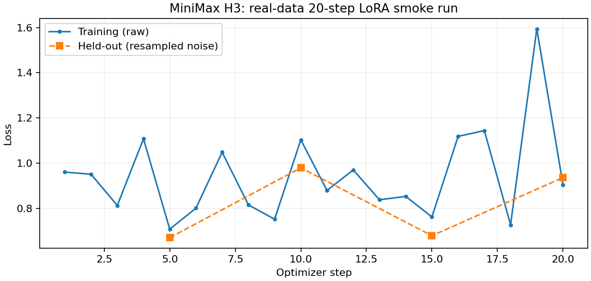

# MiniMax-H3

Synchronized text-to-video and stereo audio with the Base 768p model.

**Verification:** Full-weight T2VA and short LoRA train/resume/infer verified on one H200 (2026-09-28)

**Runtime:** Repository-owned model, trainer and pipeline; infrastructure libraries and model assets remain dependencies.

[All models](index.md) · [Setup](#setup) · [Checkpoint](#checkpoint) · [Train](#train) · [Infer](#infer) · [Evidence](#evidence-and-loss)

## At a glance

| Item | Status |
| :--- | :--- |
| Implementation | Local to HFTrainer |
| Demo data | See [data availability](demo-data.md) |
| Convergence | Not established by the evidence on this card |

## Setup

Run commands from the repository root. Install the environment below, download the checkpoint, and prepare data before training.

```bash
python -m pip install -e ".[minimax-h3,minimax-h3-fa3]"
python -m pip install "huggingface_hub>=0.34,<2"
```

Choose a matching CUDA PyTorch wheel first. Official comparison used PyTorch 2.11.0+cu130 and FA3; training used 2.8.0+cu128 in a separate environment. See the [checkpoint download and placement guide](minimax_h3_reference.md#install-and-download). One H200 fits the demonstrated inference path by loading the conditioner and denoiser sequentially.

Download the processed base bundle below. The demo adapters are not included in this release.

## Checkpoint

[ZeyuLing/HFTrainer-MiniMax-H3-Base-FL2VA](https://huggingface.co/ZeyuLing/HFTrainer-MiniMax-H3-Base-FL2VA) · [pinned revision](https://huggingface.co/ZeyuLing/HFTrainer-MiniMax-H3-Base-FL2VA/tree/179db9782a327566da00d2d06ff067945908d5a2)

Request access on the Hub page, accept the model agreement, wait for manual approval, and run `hf auth login` first. Access is restricted to the territories allowed by the MiniMax agreement. This release packages real pretrained weights in a complete **HFTrainer bundle**. Trainer and Pipeline share the repository-owned `from_pretrained` loader. Conversion, source attribution and validation scope are recorded below.

```bash
hf download ZeyuLing/HFTrainer-MiniMax-H3-Base-FL2VA \
  --revision 179db9782a327566da00d2d06ff067945908d5a2 \
  --local-dir checkpoints/hftrainer/minimax_h3
export HFTRAINER_CHECKPOINT="$PWD/checkpoints/hftrainer/minimax_h3"
export MINIMAX_H3_ROOT="$HFTRAINER_CHECKPOINT"
```

[Conversion and validation record](evidence/checkpoints/h3.json). For LoRA export, supply a config with the same adapter rank and target modules as training. Base weights are separate from demo adapters and datasets. To export a fine-tuned bundle:

```bash
python tools/export_model.py --config configs/pretrained/export_minimax_h3.py \
  --checkpoint PATH_TO_TRAINING_CHECKPOINT --output outputs/minimax_h3_export
```

## Data

The measured run used two training clips (Ballet427 and Popular-Jazz110) and one held-out clip (Classic-dunhuang8), each initially excerpted to six seconds. **These videos and caches are not published on Hugging Face.** See [provenance and availability](demo-data.md). Supply your own authorized videos for a new run. H3 training caches use 128 × 128 × 124 frames.

## Train

After preparing compatible H3 caches with train/validation manifests:

```bash
MINIMAX_H3_CACHE_MANIFEST="$PWD/data/h3/train.jsonl" \
HFTRAINER_WORK_DIR="$PWD/outputs/h3_loss_demo" \
python tools/train.py configs/pretrained/train_minimax_h3.py \
  --cfg-options val_dataloader.dataset.manifest="$PWD/data/h3/validation.jsonl"
```

This runs 20 steps. See the [cache schema and full recipe](minimax_h3_reference.md#experimental-training). The existing end-to-end validation runner assumes machine-local source clips and is not a public download-and-train workflow.

## Infer

```bash
python tools/validation/infer_h3.py --attention-backend flash_attention_3 \
  --prompt "A dancer performs a dance routine with music." --seed 42 \
  --output outputs/h3_demo.mp4
```

The demonstrated output is 768 × 768, 124 frames at 24 FPS with 32 kHz stereo audio. Add `--checkpoint outputs/h3_loss_demo/checkpoint-iter_20` for the rank-2 demo adapter; other ranks require a matching config.

## Evidence and loss

The complete native export was checked against independently uploaded tensor hashes; its real VAE encoder output matches before and after export. Full MP4 inference was not rerun from this exported directory.

The independent official comparison matched text conditions and complete face-sample denoising latents exactly. Native VAE output retains small differences (video normalized RGB RMSE 0.000630; audio RMSE 0.0000779). This is not MP4 bit equality. The reviewed base face sample was accepted visually.



These are raw 20-step LoRA traces on two clips, without smoothing. They demonstrate execution, **not sustained loss decrease, convergence or generalization**. [Raw measurements and methodology](evidence/index.md). H3 held-out points resample noise and timestep.

## Limitations

Only T2VA was verified with full weights in this run. FL2VA, Ref2VA and multi-GPU execution need separate full-run validation. Training uses an experimental rectified-flow objective, not an official training recipe. Regenerate-2K and H3-Context-IR are not implemented. Portable SDPA does not promise exact FA3 parity.

## Sources and license

[Implementation provenance and model agreement](minimax_h3_reference.md#source-and-license). Original source-freeze checkpoint revision: `42ed227ee7df40d41602854ae760620d6eb651fe`; independent official raw-FL2VA comparison: `a9e1d8408c3453c899d151d0aa448082c10b0185`. These are distinct revisions.
