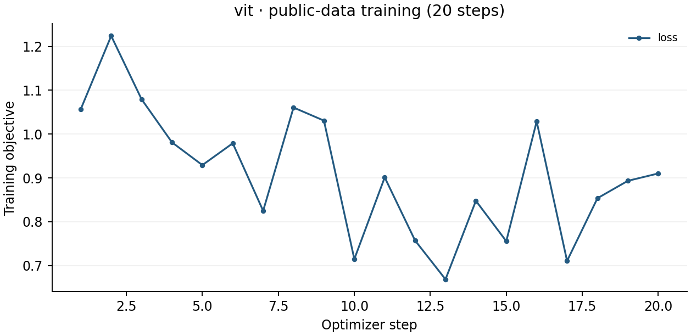
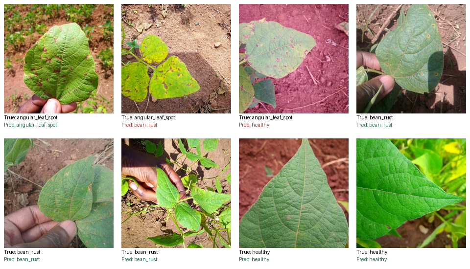

# Vision Transformer · ViT-B/16

Image classification with repository-owned model, trainer and inference code.

**Verified:** 20 real-data training steps, saved checkpoint and native checkpoint-only base inference. **Convergence is not established.**

[All models](index.md) · [Settings](#settings-and-checkpoints) · [Train](#train) · [Infer](#infer) · [Evidence](#evidence-and-loss) · [Demos](#demos)

## At a glance

| Property | Released setting |
| :--- | :--- |
| Model | Base · patch 16 · 224 px |
| Training | Full encoder + new three-class head |
| Training input | 224 × 224 |
| Public dataset | [beans](https://huggingface.co/datasets/ZeyuLing/hftrainer_beans) |
| Runtime | Local HFTrainer implementation; supporting PyTorch/media libraries and model assets remain dependencies |

## Sources

[Original paper / report](https://arxiv.org/abs/2010.11929) · [Original code](https://github.com/google-research/vision_transformer)

The original repository is provenance, not a runtime checkout requirement. [Third-party notices](https://github.com/ZeyuLing/HFTrainer/blob/main/THIRD_PARTY_NOTICES.md) preserve implementation and asset terms.

## Settings and checkpoints

| Setting | Training config | Processed checkpoint | Access |
| :--- | :--- | :--- | :--- |
| Base · patch 16 · 224 px | [config.py](https://github.com/ZeyuLing/HFTrainer/blob/main/configs/public_data/vit.py) | [HFTrainer-ViT-Base-Patch16-224](https://huggingface.co/ZeyuLing/HFTrainer-ViT-Base-Patch16-224) | Public |

Only the setting above is a released HFTrainer artifact. Its [root config.json](https://huggingface.co/ZeyuLing/HFTrainer-ViT-Base-Patch16-224/resolve/18ca4731e4d1d3f168638a13cd925f759c8cee8c/config.json), weights and all task-required component configs, processors and schedulers are included together. Inference needs **only the checkpoint path or Hub ID**, plus task inputs.

Pinned weight revision: [`18ca4731e4d1`](https://huggingface.co/ZeyuLing/HFTrainer-ViT-Base-Patch16-224/tree/18ca4731e4d1d3f168638a13cd925f759c8cee8c). [Original conversion evidence](evidence/checkpoints/vit.json) describes the initial export; the current revision adds checkpoint-only dispatch metadata without changing tensors.

## Setup

Run from the repository root:

```bash
python -m pip install -e "."
python -m pip install "huggingface_hub>=0.34,<2"
```

Verified on one NVIDIA H200 with PyTorch 2.8.0+cu128. This is the tested environment, not a measured minimum-memory requirement.

## Data

The recipe downloads [`ZeyuLing/hftrainer_beans`](https://huggingface.co/datasets/ZeyuLing/hftrainer_beans/tree/712f72df3166cf40eacae68df26330f7096b0685) to `data/hftrainer_beans`. Split counts: **1034 train / 133 validation / 128 test**. Dataset source, license, transformations and checksum verification are documented in [Public demo datasets](demo-data.md).

Model features are cached locally when required. The script never substitutes synthetic samples for missing real media.

## Train

One command downloads pinned data and weights, prepares required caches, and runs the 20-step recipe:

```bash
python tools/run_public_demo.py vit
```

Reuse downloaded weights with `--checkpoint path/to/complete_bundle`; change the output directory with `--work-dir path/to/run`. The underlying command is `python tools/train.py configs/public_data/vit.py`. Seed: **42**. Training logs and checkpoints are saved under `work_dirs/public_data/vit/`. If you reused a custom checkpoint directory, set `HFTRAINER_CHECKPOINT` to that directory before directly invoking training, resume or export commands.

The final resumable checkpoint is `work_dirs/public_data/vit/checkpoint-iter_20`. For a longer resumed run, keep the same checkpoint/data setting:

```bash
python tools/train.py configs/public_data/vit.py --auto-resume \
  --cfg-options train_cfg.max_iters=40
```

## Infer

Run the processed **pretrained base**, independently of any training config:

```bash
python tools/infer.py --model ZeyuLing/HFTrainer-ViT-Base-Patch16-224 \
  --revision 18ca4731e4d1d3f168638a13cd925f759c8cee8c --device cuda --seed 42 \
  --input path/to/image.jpg
```

`--model` also accepts a local complete checkpoint directory. A resumable training checkpoint is not a standalone model: export with `tools/export_model.py` using the matching training config, then pass the exported directory to `--model`. [Artifact and configuration contract](standard.md#checkpoint-and-execution-contract).

To package this training run as a complete checkpoint (including its frozen base components):

```bash
python tools/export_model.py --config configs/public_data/vit.py \
  --checkpoint work_dirs/public_data/vit/checkpoint-iter_20 --output exports/vit
```

Then run the inference command above with `--model exports/vit` and omit `--revision`. Complete exports duplicate the base weights; allow sufficient disk space.

## Evidence and loss

Full pretrained export/reload produced identical logits; tiny numerical reference checks also pass.



[Raw training record](evidence/public_data/vit.json) · [Training log](evidence/public_data/vit.log)

These are raw, unsmoothed objectives on the public dataset. Twenty steps establish pipeline execution, not convergence. Loss values are not comparable across models.

**Held-out accuracy:** 72.18% on all 133 Beans validation images after 20 steps. The 128-image test split was not used to tune this run.

## Demos



Eight fixed validation examples, labels and predictions from the trained three-class head. The published base uses its original ImageNet head.

## Limitations

Only B/16 at 224 px is packaged here. Upstream Large/Huge variants are not released HFTrainer settings. The published base has its original ImageNet head; the Beans recipe replaces it with three classes.

## Citation

```bibtex
@misc{dosovitskiy2021vit,
  title = {An Image is Worth 16x16 Words: Transformers for Image Recognition at Scale},
  author = {Alexey Dosovitskiy and others},
  year = {2021},
  eprint = {2010.11929},
  archivePrefix = {arXiv},
  url = {https://arxiv.org/abs/2010.11929}
}
```

Also retain the [dataset citation and attribution](demo-data.md#provenance-and-transformations).
