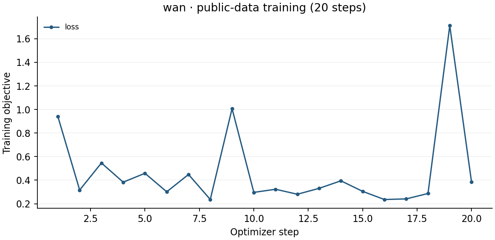

# Wan 2.1 · T2V 1.3B

Text-to-video generation with repository-owned model, trainer and inference code.

**Verified:** 20 real-data training steps, saved checkpoint and native checkpoint-only base inference. **Convergence is not established.**

[All models](index.md) · [Settings](#settings-and-checkpoints) · [Train](#train) · [Infer](#infer) · [Evidence](#evidence-and-loss) · [Demos](#demos)

## At a glance

| Property | Released setting |
| :--- | :--- |
| Model | Wan 2.1 T2V · 1.3B |
| Training | Full transformer; frozen UMT5 and VAE |
| Training input | 128 × 128 × 17 frames; video only |
| Public dataset | [crema_d_mini](https://huggingface.co/datasets/ZeyuLing/hftrainer_crema_d_mini) |
| Runtime | Local HFTrainer implementation; supporting PyTorch/media libraries and model assets remain dependencies |

## Sources

[Original paper / report](https://arxiv.org/abs/2503.20314) · [Original code](https://github.com/Wan-Video/Wan2.1)

The original repository is provenance, not a runtime checkout requirement. [Third-party notices](https://github.com/ZeyuLing/HFTrainer/blob/main/THIRD_PARTY_NOTICES.md) preserve implementation and asset terms.

## Settings and checkpoints

| Setting | Training config | Processed checkpoint | Access |
| :--- | :--- | :--- | :--- |
| Wan 2.1 T2V · 1.3B | [config.py](https://github.com/ZeyuLing/HFTrainer/blob/main/configs/public_data/wan.py) | [HFTrainer-Wan2.1-T2V-1.3B](https://huggingface.co/ZeyuLing/HFTrainer-Wan2.1-T2V-1.3B) | Public |

Only the setting above is a released HFTrainer artifact. Its [root config.json](https://huggingface.co/ZeyuLing/HFTrainer-Wan2.1-T2V-1.3B/resolve/f4a5bc6cd9b9bdc801eac0585963b0365ab22e9f/config.json), weights and all task-required component configs, processors and schedulers are included together. Inference needs **only the checkpoint path or Hub ID**, plus task inputs.

Pinned weight revision: [`f4a5bc6cd9b9`](https://huggingface.co/ZeyuLing/HFTrainer-Wan2.1-T2V-1.3B/tree/f4a5bc6cd9b9bdc801eac0585963b0365ab22e9f). [Original conversion evidence](evidence/checkpoints/wan.json) describes the initial export; the current revision adds checkpoint-only dispatch metadata without changing tensors.

## Setup

Run from the repository root:

```bash
python -m pip install -e .
python -m pip install "huggingface_hub>=0.34,<2" "av>=14,<17"
```

Verified on one NVIDIA H200 with PyTorch 2.8.0+cu128. This is the tested environment, not a measured minimum-memory requirement. Install system FFmpeg (`ffmpeg` and `ffprobe`) for media preparation.

## Data

The recipe downloads [`ZeyuLing/hftrainer_crema_d_mini`](https://huggingface.co/datasets/ZeyuLing/hftrainer_crema_d_mini/tree/1188c5d5fac3e69ea014831ab4409f729f8eda81) to `data/hftrainer_crema_d_mini`. Split counts: **24 train / 8 validation / 0 test**. Dataset source, license, transformations and checksum verification are documented in [Public demo datasets](demo-data.md).

Model features are cached locally when required. The script never substitutes synthetic samples for missing real media.

## Train

One command downloads pinned data and weights, prepares required caches, and runs the 20-step recipe:

```bash
python tools/run_public_demo.py wan
```

Reuse downloaded weights with `--checkpoint path/to/complete_bundle`; change the output directory with `--work-dir path/to/run`. The underlying command is `python tools/train.py configs/public_data/wan.py`. Seed: **42**. Training logs and checkpoints are saved under `work_dirs/public_data/wan/`. If you reused a custom checkpoint directory, set `HFTRAINER_CHECKPOINT` to that directory before directly invoking training, resume or export commands.

The final resumable checkpoint is `work_dirs/public_data/wan/checkpoint-iter_20`. For a longer resumed run, keep the same checkpoint/data setting:

```bash
python tools/train.py configs/public_data/wan.py --auto-resume \
  --cfg-options train_cfg.max_iters=40
```

## Infer

Run the processed **pretrained base**, independently of any training config:

```bash
python tools/infer.py --model ZeyuLing/HFTrainer-Wan2.1-T2V-1.3B \
  --revision f4a5bc6cd9b9bdc801eac0585963b0365ab22e9f --device cuda --seed 42 \
  --prompt "A butterfly rests on a flower. The camera is steady in natural daylight." \
  --height 480 --width 832 --num-frames 17 --num-steps 50 --output outputs/wan.mp4
```

`--model` also accepts a local complete checkpoint directory. A resumable training checkpoint is not a standalone model: export with `tools/export_model.py` using the matching training config, then pass the exported directory to `--model`. [Artifact and configuration contract](standard.md#checkpoint-and-execution-contract).

To package this training run as a complete checkpoint (including its frozen base components):

```bash
python tools/export_model.py --config configs/public_data/wan.py \
  --checkpoint work_dirs/public_data/wan/checkpoint-iter_20 --output exports/wan
```

Then run the inference command above with `--model exports/wan` and omit `--revision`. Complete exports duplicate the base weights; allow sufficient disk space.

## Evidence and loss

Complete 1.3B transformer, UMT5 and causal VAE weights load strictly. Full components match across export/reload; tiny UMT5/VAE reference outputs match exactly, and tiny transformer FP32 maximum error is 3.58e-7.



[Raw training record](evidence/public_data/wan.json) · [Training log](evidence/public_data/wan.log)

These are raw, unsmoothed objectives on the public dataset. Twenty steps establish pipeline execution, not convergence. Loss values are not comparable across models.

No held-out perceptual quality metric was measured for this short run.

## Demos

[](evidence/public_data/wan_demo.mp4)

[Play/download the generated video](evidence/public_data/wan_demo.mp4). Untouched published base, seed 42; prompt and sampler settings match the inference command above. Video-only preview: 480 × 832, 17 frames; CFG 5 and flow shift 3. This is separate from the short public-data fine-tuning run.

## Limitations

The public training run is reduced-resolution and uses only CREMA-D video, not its audio. The preview uses 480 × 832, 17 frames, 50 Euler steps, CFG 5 and flow shift 3. Euler sampling is not the official UniPC/DPM++ solver, so no official quality-parity result is claimed. UMT5 tokenization uses an NFKC approximation of the precompiled SentencePiece normalizer; arbitrary-text parity is unestablished. The 14B and image-to-video variants are not packaged.

## Citation

```bibtex
@misc{wan2025,
  title = {Wan: Open and Advanced Large-Scale Video Generative Models},
  author = {Team Wan and others},
  year = {2025},
  eprint = {2503.20314},
  archivePrefix = {arXiv},
  url = {https://arxiv.org/abs/2503.20314}
}
```

Also retain the [dataset citation and attribution](demo-data.md#provenance-and-transformations).
